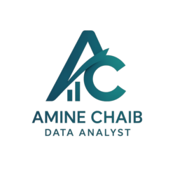

# GDA – Gestion d'Arrivage

<p align="center">
  
</p>

<h3 align="center">Gestion d'Arrivage</h3>

<p align="center">
  A powerful and intuitive web application for managing, searching, filtering, and organizing incoming stock and Excel-based product data.
</p>

<p align="center">
  <strong>Laravel API · React · PHP · JavaScript · MySQL</strong>
</p>

---

## About the Project

**GDA (Gestion d'Arrivage)** is a web application designed to simplify and centralize the management of incoming goods, stock arrivals, and product information.

Built to handle large volumes of Excel-based product data, GDA provides a centralized platform where users can efficiently manage, search, filter, sort, and export records without having to navigate through multiple spreadsheets.

The application helps streamline daily operations by making product information more accessible, organized, and easier to manage.

### Key Information Managed

- Product References
- Product Descriptions
- Brands
- Suppliers
- Purchase Prices
- Arrival Dates
- Other relevant product and stock information

## Features

- **Data Management:** Manage large datasets containing product and arrival information.
- **Advanced Search:** Quickly locate products using references and other available fields.
- **Smart Filtering:** Filter records by brand, supplier, price, arrival date, and other criteria.
- **Data Sorting:** Organize records and reorder table rows efficiently.
- **Data Export:** Export searched and filtered results for reporting and further processing.
- **Quick Copying:** Copy individual values or selected data with ease.
- **Excel Integration:** Designed around an Excel-oriented workflow for handling large datasets.
- **Centralized Management:** Keep product and arrival information organized in one place.
- **User-Friendly Interface:** Clean and intuitive interface designed for productivity.
- **API-Based Architecture:** Laravel backend API connected to a React frontend.

## Technologies Used

| Technology | Purpose |
|---|---|
| Laravel | Backend API and application logic |
| PHP | Backend development |
| React | Frontend user interface |
| JavaScript | Frontend functionality |
| Vite | Frontend development server and build tool |
| MySQL | Database management |
| Composer | PHP dependency management |
| npm | JavaScript dependency management |

---

## Installation & Setup

Follow these instructions to install and run GDA locally.

### Prerequisites

Make sure the following tools are installed on your machine:

- PHP
- Composer
- Node.js and npm
- MySQL or another database supported by your Laravel configuration
- Git

### 1. Clone the Repository

```bash
git clone https://github.com/aminechaib/GDA-REACT-API-LARAVEL-PROD-v.git
```

Navigate to the project directory:

```bash
cd GDA-REACT-API-LARAVEL-PROD-v
```

### 2. Install Backend Dependencies

Install the Laravel dependencies:

```bash
composer install
```

### 3. Configure the Laravel Environment

Create your `.env` file from the example configuration.

**Windows PowerShell:**

```powershell
Copy-Item .env.example .env
```

**Linux / macOS:**

```bash
cp .env.example .env
```

Generate the Laravel application key:

```bash
php artisan key:generate
```

### 4. Configure the Database

Open your `.env` file and configure your database connection.

Example using MySQL:

```env
DB_CONNECTION=mysql
DB_HOST=127.0.0.1
DB_PORT=3306
DB_DATABASE=gda
DB_USERNAME=root
DB_PASSWORD=
```

Create a database named `gda` in MySQL before proceeding.

### 5. Run Database Migrations & Seeders

Create the database tables:

```bash
php artisan migrate
```

Populate the database with the initial data:

```bash
php artisan db:seed
```

Alternatively, execute migrations and seeders together:

```bash
php artisan migrate --seed
```

This initializes the database with the records defined in the project's seeders, including the default administrator account if configured in `DatabaseSeeder`.

### 6. Default Administrator Account

After running the database seeders, use the following credentials to access the application, provided the default administrator seeder is configured.

| Field | Value |
|---|---|
| Email | `admin@example.com` |
| Password | `password123` |
| Role | Administrator |

**Login credentials:**

```text
Email:    admin@example.com
Password: password123
```

> **Security Notice:** These are development credentials. Change the default password immediately when deploying the application to a production environment. Never use default credentials on a publicly accessible server.

### 7. Start the Laravel Backend

Run the Laravel development server:

```bash
php artisan serve
```

The backend API will be available at:

```text
http://127.0.0.1:8000
```

Keep this terminal running.

### 8. Install Frontend Dependencies

Open a new terminal and navigate to the frontend directory:

```bash
cd frontend
```

Install the required npm packages:

```bash
npm install
```

### 9. Start the React Frontend

Run the Vite development server:

```bash
npm run dev
```

Vite will display a local development URL in your terminal.

Open that URL in your browser to access GDA.

**Congratulations! Your GDA application is now running locally.**

Make sure both the Laravel backend and React frontend servers remain running while using the application.

---

## Database Management

GDA uses Laravel migrations and seeders to manage database initialization.

Useful Artisan commands:

| Command | Description |
|---|---|
| `php artisan migrate` | Run pending migrations |
| `php artisan migrate --seed` | Run migrations and seed the database |
| `php artisan db:seed` | Execute database seeders |
| `php artisan migrate:fresh --seed` | Drop all tables, recreate them, and seed the database |
| `php artisan migrate:status` | Check migration status |

**Important:** `migrate:fresh --seed` deletes all existing database tables and their data. Use it only when you intentionally want to reset the database.

---

## Project Structure

```text
GDA-REACT-API-LARAVEL-PROD-v/
│
├── app/                       # Laravel application logic
│
├── bootstrap/                 # Laravel bootstrap files
│
├── config/                    # Application configuration
│
├── database/
│   ├── migrations/             # Database table migrations
│   ├── seeders/                # Database seeders
│   └── factories/              # Model factories
│
├── public/                    # Public assets
│
├── routes/
│   ├── api.php                 # API routes
│   └── web.php                 # Web routes
│
├── storage/                   # Application storage
│
├── frontend/                  # React frontend
│   ├── src/                    # React source code
│   ├── public/                 # Frontend public assets
│   ├── package.json            # Frontend dependencies
│   └── ...
│
├── resources/                 # Laravel resources
│
├── .env.example               # Environment configuration template
├── artisan                    # Laravel CLI
├── composer.json              # PHP dependencies
├── logo.png                   # Project logo
└── README.md                  # Project documentation
```

---

## Developer

<p align="center">
  Made with dedication by <strong>Amine Chaib</strong>
</p>

---

<p align="center">
  <strong>GDA – Gestion d'Arrivage</strong><br>
  Simplifying data management, one arrival at a time.
</p>
